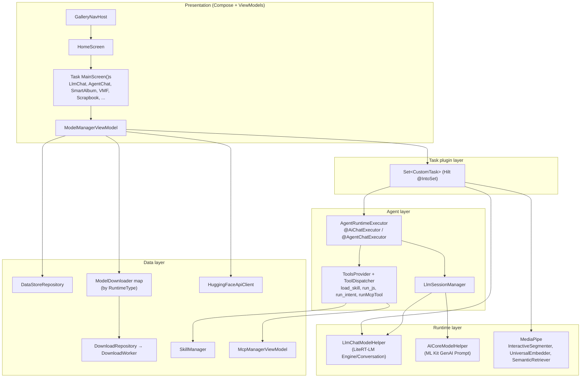
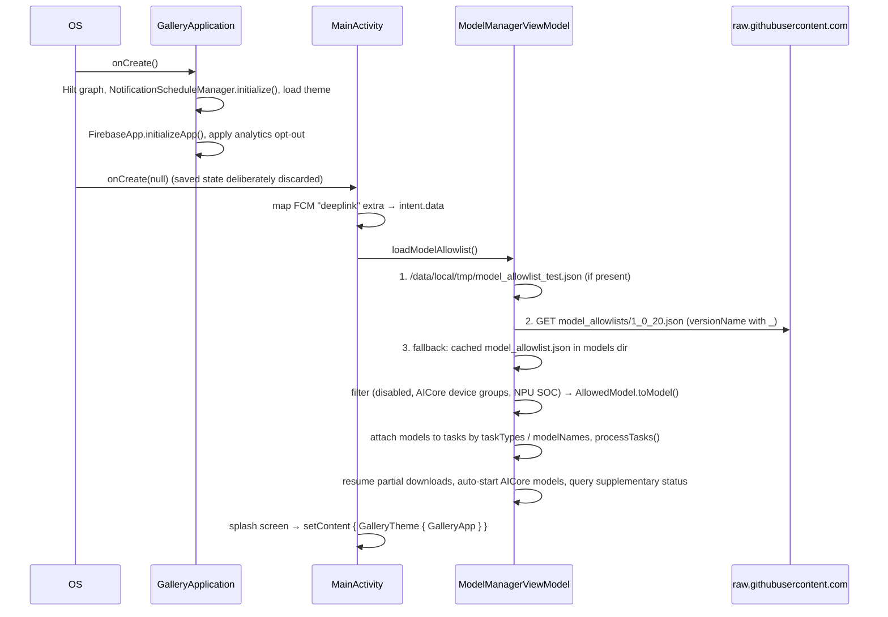

# Architecture

## 1. Summary

Single-module Android app (`:app`), Kotlin + Jetpack Compose, dependency injection with Hilt.
Features are **tasks** that plug in through a Hilt multibinding (`Set<CustomTask>`). Each task owns its
screen and its model lifecycle. A central `ModelManagerViewModel` loads a remote **model allowlist**, attaches
models to tasks, and drives download, initialization, and cleanup. Inference runs on-device through one of two
LLM runtimes, picked per model:

- **LiteRT-LM** (`LlmChatModelHelper`)
- **Android AICore** via ML Kit GenAI Prompt (`AICoreModelHelper`)

Non-LLM features use MediaPipe (segmentation, embeddings, retrieval).

## 2. Repository layout

| Path | Contents |
|------|----------|
| `Android/src/` | Gradle root (`settings.gradle.kts`, wrapper, `gradle/libs.versions.toml`) |
| `Android/src/app/` | The only module: app code, resources, protos, assets |
| `Android/src/app/src/main/java/com/google/ai/edge/gallery/` | Kotlin sources (`gallery/`) |
| `Android/src/app/src/main/proto/` | Protobuf schemas for DataStore and persisted state |
| `Android/src/app/src/main/assets/skills/` | Built-in Agent Skills bundled in the APK |
| `Android/src/app/src/main/assets/tinygarden/` | Tiny Garden web game (minified bundle) |
| `model_allowlists/` | Versioned model catalogs fetched at runtime (`<versionName with _>.json`) |
| `model_allowlist.json` | Legacy catalog (4 `.task` models); not read by the current Android code **[inferred]** |
| `skills/` | Community and featured skills, published to GitHub Pages by CI |
| `mcp/` | MCP user guide and screenshots |
| `.github/` | CI workflows, issue and discussion templates |

## 3. Package map (`gallery/`)

| Package | Responsibility | Key types |
|---------|----------------|-----------|
| *(root)* | App entry, analytics, FCM, DataStore serializers | `GalleryApplication`, `MainActivity`, `GalleryApp`, `Analytics.kt`, `FcmMessagingService.kt` |
| `di/` | Hilt singletons: DataStores, repositories, downloaders, dispatchers | `AppModule`, `CoroutinesModule` |
| `data/` | Domain model and repositories | `Task`, `Model`, `ModelAllowlist`, `Config`, `DataStoreRepository`, `DownloadRepository`, `ModelDownloader`, `ChatSessionRepository`, `SystemPromptRepository` |
| `ui/` | Shared UI and the built-in LLM screens | `navigation/GalleryNavGraph`, `home/`, `modelmanager/`, `llmchat/`, `llmsingleturn/`, `benchmark/`, `common/`, `theme/` |
| `customtasks/` | Pluggable feature tasks | `common/CustomTask`, `agentchat/`, `smartalbum/`, `videomomentfinder/`, `scrapbook/`, `mobileactions/`, `tinygarden/`, `examplecustomtask/` |
| `agent/` | Agent runtime abstraction and LLM session management | `AgentRuntimeExecutor`, `DefaultAgentRuntimeExecutor`, `sessions/LlmSessionManager`, `sessions/SummarizationContextCompactor` |
| `tools/` | Tool definitions exposed to the LLM, and tool-to-UI action events | `ToolDefinition`, `LoadSkillTool`, `RunJsTool`, `RunIntentTool`, `RunMcpTool`, `ToolAction` |
| `skills/` | Skill storage, parsing, and loading | `SkillManager`, `SkillsProvider` |
| `mcp/` | MCP server state contract | `McpServersProvider` |
| `runtime/` | LLM runtime abstraction plus the AICore implementation | `LlmModelHelper`, `ModelHelperExt.runtimeHelper`, `aicore/AICoreModelHelper` |
| `services/` | Platform services | `photolibrary/PhotoLibraryService`, `semanticretrieval/*` (EmbeddingGemma + vector store) |
| `huggingface/` | Hugging Face REST client | `HuggingFaceApiClient` |
| `intents/` | Android intent actions callable by the agent | `IntentHandler` |
| `notifications/` | Scheduled local notifications | `NotificationScheduleManager`, `NotificationReceiver`, `BootReceiver` |
| `worker/` | WorkManager model download | `DownloadWorker` |
| `common/` | Utilities, project config, metrics | `ProjectConfig`, `Utils.kt`, `metrics/*` |

## 4. Layered view

Dependency direction: Presentation → Tasks → Agent → Runtime, with Data used by every layer. Two shortcuts exist:

- Several tasks (Prompt Lab, Mobile Actions, Tiny Garden) call `LlmChatModelHelper` directly, without the agent layer.
- `McpManagerViewModel` is a ViewModel, yet the agent tools use it as the MCP provider (see [14-known-issues](14-known-issues.md)).

## 5. Task plugin model

A **Task** (`data/Tasks.kt`) is a home-screen feature: id, label, category, icon, description, models, and
capability flags (`supportImage`, `supportAudio`, `supportContextCompact`). A **CustomTask**
(`customtasks/common/CustomTask.kt`) adds four things:

| Member | Purpose |
|--------|---------|
| `task: Task` | Metadata and the mutable model list |
| `initializeModelFn(context, scope, model, systemInstruction, onDone)` | Load the model into memory. `onDone("")` means success; a non-empty string is the error. |
| `cleanUpModelFn(...)` | Release native resources |
| `@Composable MainScreen(data: Any)` | The task UI. Receives `CustomTaskData` or `CustomTaskDataForBuiltinTask`. |
| `keepModelAlive`, `onDeleteModelFn`, `onDeleteExtraDataFn` | Optional lifecycle hooks |

Registration is a Hilt module with `@Provides @IntoSet fun provideTask(): CustomTask`.
`ModelManagerViewModel` gets `Set<CustomTask>` injected and builds the home screen from it.

Registered tasks (`BuiltInTaskId`):

| Task id | Label | Module | Runtime |
|---------|-------|--------|---------|
| `llm_chat` | AI Chat | `ui/llmchat/LlmChatTaskModule` | `@AiChatExecutor` → LiteRT-LM / AICore |
| `llm_test` | Test chat (imported models) | `ui/llmchat/LlmTestTaskModule` | `@AiChatExecutor` |
| `llm_ask_image` | Ask Image | `ui/llmchat/LlmChatTaskModule` | `@AiChatExecutor` |
| `llm_ask_audio` | Audio Scribe | `ui/llmchat/LlmChatTaskModule` | `@AiChatExecutor` |
| `llm_prompt_lab` | Prompt Lab | `ui/llmsingleturn/LlmSingleTurnTaskModule` | `LlmChatModelHelper` directly |
| `llm_agent_chat` | Agent Skills | `customtasks/agentchat/AgentChatTaskModule` | `@AgentChatExecutor` (skills + MCP + intents) |
| `llm_mobile_actions` | Mobile Actions | `customtasks/mobileactions/MobileActionsModule` | `LlmChatModelHelper` with tools |
| `llm_tiny_garden` | Tiny Garden | `customtasks/tinygarden/TinyGardenTaskModule` | `LlmChatModelHelper` with tools |
| `mp_scrapbook` | Scrapbook ("Magic touch") | `customtasks/scrapbook/ScrapbookTaskModule` | MediaPipe `InteractiveSegmenter` |
| `smart_album` | Instant Media Search | `customtasks/smartalbum/SmartAlbumTaskModule` | EmbeddingGemma via MediaPipe `UniversalEmbedder` |
| `video_moment_finder` | Video Moment Finder | `customtasks/videomomentfinder/VideoMomentFinderTaskModule` | EmbeddingGemma |
| `example_custom_task` | Model Viewer (sample) | `customtasks/examplecustomtask/ExampleCustomTaskModule` | **Disabled**: `@Provides` is commented out |

Home ordering comes from `PREDEFINED_LLM_TASK_ORDER` in `ModelManagerViewModel`.

## 6. Startup sequence

## 7. Navigation

`ui/navigation/GalleryNavGraph.kt` is a single `NavHost`:

| Route | Screen |
|-------|--------|
| `homepage` (start) | `HomeScreen`: task tiles grouped by category |
| `model_list` | Models for the selected task |
| `route_model/{taskId}/{modelName}?query={query}` | `CustomTaskScreen` → `task.MainScreen()` |
| `model_manager?<importUrl>` | Global model manager (downloaded models, imports, Hugging Face explore) |
| `benchmark/{modelName}` | LLM benchmark |
| `notifications` | Scheduled local notifications |

Deep links (scheme `com.google.ai.edge.gallery`, declared in the manifest):

| URI | Effect |
|-----|--------|
| `com.google.ai.edge.gallery://model/<taskId>/<modelName>?query=<text>` | Open a specific model in a task |
| `com.google.ai.edge.gallery://<taskId>?query=<text>` | Open a task with its first downloaded model, or else its first model |
| `com.google.ai.edge.gallery://global_model_manager` or `://import` | Open the model manager |

`query` is untrusted input. `CustomTaskDataForBuiltinTask.initialQuery` documents that it must be shown to the user and
confirmed before it is sent to a model. Today only Agent Skills (`AgentChatScreen`) reads it, and it confirms through
`ExternalPromptConfirmationDialog`. Every other task ignores `query`. FCM pushes can carry a `deeplink`
data field. `http(s)` links open in the browser; anything else is routed as an in-app deep link.

## 8. Model lifecycle (per task screen)

1. The user picks a model. `ModelManagerViewModel.selectModel()` runs.
2. `initializeModel(task, model)` skips if the model is already initialized or initializing. Otherwise it cleans up, marks
   `Initializing`, and calls `CustomTask.initializeModelFn` on `Dispatchers.IO` with the effective system prompt
   (`SystemPromptHelper`).
3. State lives in `Model.initStatusFlow`: `Idle → Initializing → Initialized(instance) | Failed(error)`.
4. `cleanupModel()` releases the instance. If cleanup is requested during initialization, it sets
   `cleanUpAfterInit`, and the model is cleaned up as soon as initialization finishes.
5. A config change marked `needReinitialization` re-initializes the model, unless the task sets
   `handleModelConfigChangesInTask`.

Only **one active LLM session** is assumed app-wide (`LlmSessionManager` contract).

## 9. Runtime selection

`Model.runtimeHelper` (`runtime/ModelHelperExt.kt`):

| Condition | Helper |
|-----------|--------|
| `testingModelHelper` set (test hook) | that helper |
| `backendSpec.runtimeType == AICORE` | `AICoreModelHelper` |
| otherwise | `LlmChatModelHelper` (LiteRT-LM) |

Downloading is picked separately: a Hilt map `Map<RuntimeType, ModelDownloader>` (`@RuntimeTypeKey`) maps
`UNKNOWN`/`LITERT_LM` to `LiteRtLmModelDownloader` and `AICORE` to `AICoreModelDownloader`.

## 10. Cross-cutting concerns

| Concern | Where |
|---------|-------|
| Persistence | Proto DataStores in `filesDir/datastore/*.pb` (see [04-technical-design §6](04-technical-design.md#6-persistence)) |
| Background work | WorkManager: `DownloadWorker`, `SmartAlbumIndexingWorker` (both foreground `dataSync`) |
| Concurrency | `CoroutinesModule` qualifiers `@IoDispatcher`, `@DefaultDispatcher`, `@MainDispatcher`, `@ApplicationScope` |
| Telemetry | Firebase Analytics events (`GalleryEvent`), inference metrics (`common/metrics/*`) |
| Theming | `ui/theme/*`, persisted `Theme` enum |
| Permissions | Runtime requests from screens and tools (`RequestPermissionToolAction`) |

See also: [02-agents](02-agents.md), [04-technical-design](04-technical-design.md), [12-architecture-decisions](12-architecture-decisions.md).
