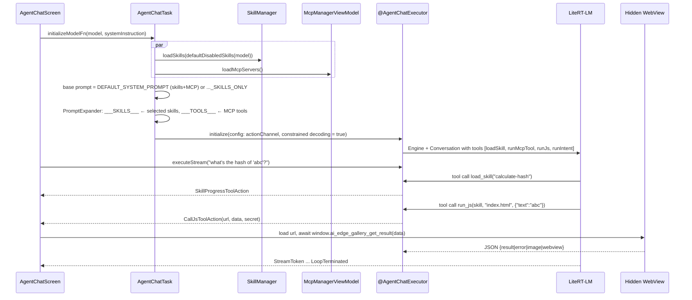

# Agents

This document covers the **in-app agent system**: how an on-device LLM is given tools, skills, MCP servers,
and Android intents. Instructions for AI *coding* assistants working on this repo are in [AGENTS.md](../AGENTS.md).

## 1. Concepts

| Term | Meaning |
|------|---------|
| **Agent runtime executor** | Runs one ReAct-style turn loop on an initialized model and streams `AgentEvent`s. |
| **Session** | A conversation history identified by a UUID. It is not tied to one model. Only one session is active app-wide. |
| **Tool** | A Kotlin method annotated with LiteRT-LM `@Tool`/`@ToolParam` that the model can call. |
| **Skill** | A `SKILL.md` instruction pack, optionally with JS scripts, that the model loads on demand with a tool call. |
| **MCP server** | A remote Model Context Protocol server reached over StreamableHTTP. Its tools are listed in the system prompt. |
| **Intent** | A native Android action (email, SMS, calendar, notification) the model can trigger. |
| **Tool action** | A message from a running tool to the UI (run JS, ask for a secret, ask permission, show progress). |

## 2. Executors

`agent/AgentRuntimeExecutor.kt` defines the contract:

| Method | Purpose |
|--------|---------|
| `initialize(context, AgentRuntimeConfig, onDone)` | Build `SessionConfig`, attach tools, initialize the model through `model.runtimeHelper`. If the model is already loaded, reset the session instead. |
| `executeStream(AgentExecutionContext, AgentRequest): Flow<AgentEvent>` | Cold flow for one turn |
| `execute(...)` | Collects `executeStream` into an `AgentResponse` |
| `interrupt()` | Stop generation (`LlmSessionManager.stopResponse`) |
| `resetSession(config)` | Re-seed the conversation (prompt change, tool toggles, rollback) |
| `cleanUp(onDone)` | Release the model instance |

Implementations must be thread-safe. `DefaultAgentRuntimeExecutor` keeps its state in an
`AtomicReference<ActiveSession>`.

Two Hilt singletons are qualified by annotation:

| Qualifier | Built in | Skills | Tools | Used by |
|-----------|----------|--------|-------|---------|
| `@AiChatExecutor` | `agent/AgentExecutorModule` | `NoOpSkillsProvider` | none (`RuntimeToolsProvider()`) | AI Chat, Ask Image, Audio Scribe, Test chat |
| `@AgentChatExecutor` | `customtasks/agentchat/AgentChatTaskModule` | `SkillManager` | `AgentTools` (4 built-in tools + runtime-registered) | Agent Skills |

### Events (`AgentEvent`)

`LoopInitiated` → `StreamToken(token, thinking?, done)`* → `LoopTerminated(finalResponse)`.
`LoopCancelled` and `Error(message)` can also end a turn. Context compaction adds
`ContextCompactionStarted` and `ContextCompactionFinished(success)`.
Tokens that start with `<ctrl` are filtered out.

### Request metadata

| Key | Type | Effect |
|-----|------|--------|
| `AgentRequest.SESSION_ID` (`"sessionId"`) | String | Target session. Defaults to the active session. |
| `AgentRequest.LITERTLM_EXTRA_CONTEXT` | `Map<String,String>` | Passed to the engine, e.g. `enable_thinking`, `max_output_tokens`, `multi_turn_vision_session` |

Attachments: `ImageBitmap`, `AudioBytes` (both used today). `ImageUri`, `AudioUri` and `File` are defined but
`DefaultAgentRuntimeExecutor` ignores them **[current]**.

## 3. Agent Skills task (`llm_agent_chat`) end to end



### System prompt templates

`AgentChatTaskModule.kt` defines two templates:

- `DEFAULT_SYSTEM_PROMPT`: route the request to a Skill (flow A) or an MCP tool (flow B).
- `DEFAULT_SYSTEM_PROMPT_SKILLS_ONLY`: skills only.

Both tell the model to work silently and output only the final result. The skills+MCP template is used only when
MCP tools exist and the user hasn't customized the prompt (`getEffectiveBaseSystemPrompt`).
Placeholders: `___SKILLS___` is a list of selected skills (`- Skill name: "x"\n- Description: y`), and
`___TOOLS___` is the MCP tools prompt from `McpManagerViewModel.getToolsPrompt()`.

## 4. Tools

All tools implement `ToolDefinition` (extends LiteRT-LM `ToolSet`). They are bound to a `ToolExecutionContext`
(`taskId`, `actionChannel`) before each turn by `RuntimeToolDispatcher.setupExecutionContext`.

| Kotlin method (`@Tool`) | Class | Parameters | Returns | Side effects |
|-------------------------|-------|-----------|---------|--------------|
| `loadSkill` | `tools/LoadSkillTool` | `skillName` | `{skill_name, skill_instructions}` | Progress event |
| `runJs` | `tools/RunJsTool` | `skillName`, `scriptName` (default `index.html`), `data` (JSON string) | `{result, status}` or `{error, status}` | May prompt for a secret (`AskInfoToolAction`). Emits `CallJsToolAction`. Can set an image or webview to render. |
| `runIntent` | `tools/RunIntentTool` | `intent`, `parameters` (JSON string) | `{action, parameters, result}` | Calls `IntentHandler`. May emit `RequestPermissionToolAction`. |
| `runMcpTool` | `tools/RunMcpTool` | `toolName`, `input` (JSON string) | `{result, status}` or `{error, status}` | Emits `AskMcpToolCallPermissionAction` unless the tool is `alwaysAllow`. Logs `mcp_execution`. |

Prompts and skill docs use snake_case names (`load_skill`, `run_js`, `run_intent`) but call the MCP tool `runMcpTool`.
How LiteRT-LM exposes method names to the model is **[to verify]** (see [14-known-issues](14-known-issues.md)).

When a tool or intent name isn't found, both `RunIntentTool` and `RunMcpTool` check whether the name is actually a
skill and reply `"<type> not found. Try to run it as a skill"`. This steers the model back to the right path.

### Tool actions (tool → UI)

| `ToolActionName` | Class | UI response |
|------------------|-------|-------------|
| `CALL_JS_SKILL` | `CallJsToolAction(url, data, secret, result: CompletableDeferred<String>)` | Runs the skill page in a hidden `GalleryWebView`, completes `result` |
| `SKILL_PROGRESS` | `SkillProgressToolAction(label, inProgress, addItemTitle, addItemDescription, customData)` | Collapsible progress panel in chat |
| `ASK_INFO` | `AskInfoToolAction(dialogTitle, fieldLabel, result)` | Text dialog (used for skill secrets) |
| `REQUEST_PERMISSION` | `RequestPermissionToolAction(permission, result: Boolean)` | Android runtime permission prompt |
| `ASK_MCP_TOOL_CALL_PERMISSION` | `AskMcpToolCallPermissionAction(toolName, argument, result: PermissionResult)` | Deny / Allow once / Always allow |

The channel is `AgentToolsImpl._actionChannel` (`Channel.UNLIMITED`). The screen reads from `receiveActionChannel`.

## 5. Skills

### Sources (`SkillSource`)

| Source | Origin | Storage |
|--------|--------|---------|
| `BUILTIN` | `assets/skills/<dir>/SKILL.md` in the APK | Re-parsed on every load. Selection state is kept in `skills.pb`. |
| `FEATURED` | Remote allowlist at `SKILL_ALLOWLIST_URL` | **Empty in this build**, so the featured list is empty **[current]** |
| `REMOTE_URL` | User-entered URL to a skill folder or `SKILL.md` | `skills.pb` stores `skill_url` |
| `LOCAL_IMPORT` | User-picked folder (SAF) | Copied under `filesDir/<importDir>`, served from `https://appassets.androidplatform.net/<importDir>/...` |

Built-in skills in `assets/skills/`: `calculate-hash`, `create-calendar-event`, `interactive-map`, `kitchen-adventure`,
`learn-something-new`, `mood-tracker`, `qr-code`, `query-wikipedia`, `read-calendar-events`, `schedule-notification`,
`send-email`, `text-spinner`.

### `SKILL.md` format (as parsed by `SkillManager.convertSkillMdToProto`)

```markdown
---
name: my-skill                 # required
description: One-line purpose  # required; the model sees this when choosing a skill
metadata:
  require-secret: true         # optional; prompts once, then stored in user_data.pb
  require-secret-description: Enter your API key
  homepage: https://example.com
---
Free-form instructions loaded by load_skill.
```

The parser splits on `---` and reads keys line by line. It is not a full YAML parser: nested values,
quoting and multi-line values are not supported **[current]**.

### JS skill contract

- Entry: `scripts/<scriptName>` (default `index.html`), resolved by `Skill.getJsSkillUrl()`.
- The page must define `window.ai_edge_gallery_get_result = async (data /*, secret */) => string`.
- It returns a JSON string, parsed by Moshi into `CallJsSkillResult`:

| Field | Type | Meaning |
|-------|------|---------|
| `result` | string? | Text returned to the model |
| `error` | string? | Failure message returned to the model |
| `image.base64` | string? | Image rendered in chat |
| `webview.url` | string? | Page rendered in chat. A relative path resolves to `<skill>/assets/<url>`. |
| `webview.iframe` | bool? | Wrap the page in an iframe |
| `webview.aspectRatio` | float? | Width/height (default 4:3) |

If the JSON can't be parsed, the whole string is treated as `result`.

## 6. MCP integration

- Servers live in `mcp_servers.pb` (`McpServers` → `McpServer{url, tools[], enabled, name, version, description}`).
  Each tool has `enabled` and `always_allow` flags.
- Authentication is a custom request header (`McpAuth.RequestHeader`), stored in `user_data.pb` (`mcp_auths`).
  The proto reserves `OAuth`; the MCP README says full OAuth is not yet supported.
- Transport is `StreamableHttpClientTransport` (MCP Kotlin SDK 0.8.0) over a Ktor Android `HttpClient` with SSE.
- Only enabled tools are rendered into `___TOOLS___`. The model calls them through `runMcpTool`.
- Every call that isn't `alwaysAllow` needs user consent (Deny / Allow once / Always allow).

## 7. Android intents (`IntentHandler`)

`parameters` is a JSON string, parsed with Moshi into the params class listed.

| Intent id | Parameters (JSON keys) | Behaviour | Runtime permission |
|-----------|------------------------|-----------|--------------------|
| `send_email` | `extra_email`, `extra_subject`, `extra_text` | Opens the email composer (`ACTION_SEND`, `mailto:`) | none |
| `send_sms` | `phone_number`, `sms_body` | Opens the SMS composer (`ACTION_SENDTO`, `smsto:`) | none |
| `create_calendar_event` | `title`, `description`, `begin_time`, `end_time` (`yyyy-MM-dd'T'HH:mm:ss`) | Opens the calendar insert UI (`ACTION_INSERT`) | none |
| `read_calendar_events` | `date` (`yyyy-MM-dd`) | Queries the calendar provider for that day and returns events | `READ_CALENDAR` (requested through a tool action) |
| `get_current_date_and_time` | — | Returns `yyyy-MM-dd'T'HH:mm:ss EEEE` in the device locale | none |
| `schedule_notification` | `title`, `message`, `hour`, `minute`, optional `deeplink`, `task_id`, `model_name`, `year`, … | Schedules an AlarmManager notification (`NotificationScheduleManager`) | none requested here; `POST_NOTIFICATIONS` is declared in the manifest |

The "send" intents only open a composer. The user still confirms the actual send.

## 8. Sessions and context

`LlmSessionManager` (`DefaultLlmSessionManager`) is responsible for:

- Session create, load, reset, delete, and list. History is persisted as `ChatSessionProto` in `user_data.pb`.
- Running inference against the active model (`generateResponse`) and stopping it.
- Linking feedback ids to sessions.
- Context compaction through `ContextCompactor` (`SummarizationContextCompactor`): when token usage passes **75%** of
  max tokens (`TOKEN_LIMIT_THRESHOLD_RATIO`), it summarizes the conversation (50–1000-word budget, 0.75 words per token)
  and resets the KV cache. After a failure it backs off for 3 checks.

> Compaction is **off in this build**. `Config.isContextCompactEnabled()` returns `false`, so
> `Task.isContextCompactSupported()` is always false, even for tasks with `supportContextCompact = true`.

## 9. Other agentic tasks (direct LiteRT-LM tool use)

| Task | Model | Tools |
|------|-------|-------|
| Mobile Actions (`llm_mobile_actions`) | `MobileActions-270M` (FunctionGemma 270M fine-tune) | `turnOnFlashlight`, `turnOffFlashlight`, `createContact`, `sendEmail`, `showLocationOnMap`, `openWifiSettings`, `createCalendarEvent` |
| Tiny Garden (`llm_tiny_garden`) | `TinyGarden-270M` | `waterPlots(plots)`, `plantSeed(seed, plots)`, `harvestPlots(plots)` |

These tasks call `LlmChatModelHelper` directly with their own `ToolSet`, without going through the agent executor.
To add a Mobile Actions function, see [Function_Calling_Guide.md](../Function_Calling_Guide.md).

## 10. Extension points

| Goal | How |
|------|-----|
| New skill | Add a folder to `assets/skills/` (built-in) or publish one under `skills/` (community). See [08-how-to-guides](08-how-to-guides.md#5-write-and-test-an-agent-skill). |
| New native tool for Agent Skills | Implement `ToolDefinition`, then add it to `AgentToolsImpl.getAvailableTools()` or call `registerTool()` |
| New intent | Add an `IntentAction` entry and a branch in `IntentHandler.handleAction` |
| New executor flavour | New qualifier plus a `DefaultAgentRuntimeExecutor` with a different `SkillsProvider`/`ToolsProvider` |
