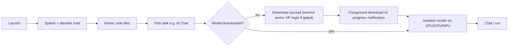

# Functional Design

## 1. Product scope

The app is a showcase and sandbox for **on-device generative AI**. Users browse tasks (features), download a
compatible model per task, and run it offline. Inference never leaves the device. Network access is used only for
model and catalog downloads, optional telemetry, user-added remote skills and MCP servers, and push notifications.

Supported OS: Android 12+ (`minSdk 31`). An iOS app and a macOS build exist (see the root README), but their source is
**not** in this repository.

## 2. Actors

| Actor | Description |
|-------|-------------|
| End user | Runs tasks, manages models, adds skills and MCP servers |
| Skill author | Writes `SKILL.md` and JS skills and shares them through GitHub Discussions or a URL |
| Catalog maintainer | Edits `model_allowlists/<version>.json` to add, enable, or disable models |
| Developer | Builds the app, adds custom tasks or functions |

## 3. Feature catalog

Model lists come from `model_allowlists/1_0_20.json` (`taskTypes`).

| Feature (task id) | User value | Models (1.0.20 allowlist) | Inputs | Key limits |
|-------------------|-----------|---------------------------|--------|-----------|
| **AI Chat** (`llm_chat`) | Multi-turn chat with optional Thinking Mode | Gemma-4-E2B/E4B-it, Gemma-3n-E2B/E4B-it, Gemma3-1B-IT, Qwen2.5-1.5B-Instruct, DeepSeek-R1-Distill-Qwen-1.5B | Text, image and audio when the model supports them, voice dictation | Context = model `maxTokens` |
| **Ask Image** (`llm_ask_image`) | Questions about photos or camera captures | Gemma-4 and Gemma-3n families | Text + images | ≤10 images per session (`MAX_IMAGE_COUNT`); 1 for AICore |
| **Audio Scribe** (`llm_ask_audio`) | Transcribe or translate speech | Gemma-4 and Gemma-3n families | Recorded or picked audio | 1 clip (`MAX_AUDIO_CLIP_COUNT`), ≤30 s, 16 kHz |
| **Prompt Lab** (`llm_prompt_lab`) | Single-turn prompting with templates and sampler control | All chat LLMs | Text | Templates: Free form, Rewrite tone, Summarize text, code snippet languages (C++, Java, JavaScript, Kotlin, Python, …) |
| **Agent Skills** (`llm_agent_chat`) | Chat that can use skills, MCP tools, and device intents | Gemma-4-E2B/E4B-it | Text, image, audio | ≤15 recommended selected skills (`MAX_RECOMMENDED_SKILL_COUNT`) |
| **Instant Media Search** (`smart_album`) | Natural-language and image-to-image search over the photo library | EmbeddingGemma-2 | Search text, a reference photo | Needs indexing first; user library or built-in sample album |
| **Video Moment Finder** (`video_moment_finder`) | Find moments in videos by description, trim and export clips | EmbeddingGemma-2 | Videos, search text | Per-project processing config (segment length, frames per segment, process sound track) |
| **Mobile Actions** (`llm_mobile_actions`) — experimental | Offline device control by voice or text | MobileActions-270M (FunctionGemma) | Text | 7 functions (see [02-agents §9](02-agents.md#9-other-agentic-tasks-direct-litert-lm-tool-use)) |
| **Tiny Garden** (`llm_tiny_garden`) — experimental | Natural-language mini-game | TinyGarden-270M (FunctionGemma) | Text | Conversation resets after N turns (default 3, range 1–30) |
| **Scrapbook** (`mp_scrapbook`) | Cut objects out of photos and make collages | "Magic touch" (MediaPipe InteractiveSegmenter) | Photo + touch strokes | — |
| **Test chat** (`llm_test`) | Chat with a side-loaded or imported model | User-imported `.litertlm` / `.task` | Text, image, audio | — |

Cross-cutting features:

| Feature | Behaviour |
|---------|-----------|
| **Model manager** | Lists allowlist models and imported models. Download, cancel, and delete. Toggle optional components (extra data files). Shows a memory warning when a model needs more RAM (`minDeviceMemoryInGb`) than the device has. |
| **Model import** | Import a local `.litertlm` (or `.task`) file with LLM configs (accelerators, max tokens, sampling defaults, image/audio/thinking support). Browse and search Hugging Face, or import by Hugging Face URL. |
| **Hugging Face sign-in** | For gated models, a probe returns `GATED` or `NEEDS_TOKEN_EXCHANGE`. The app runs an OAuth (AppAuth) login with scope `read-repos` and stores the token. |
| **Benchmark** | LiteRT-LM models only. Configurable prefill/decode tokens and runs. Results are stored and can be compared. |
| **Chat history** | Sessions persist per task. A side sheet lets users resume or delete them. |
| **Settings** | Theme (light/dark/auto), Firebase Analytics opt-out, Terms of Service, Gemma Terms, open-source licenses |
| **Terms gating** | App ToS dialog. Gemma Terms of Use must be accepted before downloading Gemma models (`DownloadAndTryButton`). |
| **Notifications screen** | Lists local notifications scheduled by skills (`schedule_notification`) and allows deleting them |
| **New release banner** | Checks `api.github.com/repos/<repo>/releases/latest` and prompts when a newer version exists |
| **Deep links** | Open a task or model directly, optionally prefilled with a query that the user must confirm (see [01-architecture §7](01-architecture.md#7-navigation)) |

## 4. Primary user flows

### 4.1 First run → first answer

### 4.2 Agent Skills: add and use a skill

1. Open Agent Skills, then the Skill manager.
2. Add a skill from Featured (empty in this build), from a URL, or from a local folder. Accept the disclaimer.
3. Enable or disable skills. Edit or test a skill in the Skill tester.
4. Ask a question. The model loads the matching skill and may run JS (hidden WebView), an intent, or an MCP tool.
5. If the skill needs a secret, the user is asked once and the secret is stored on the device.
6. Results show as text, an image, or an embedded webview card.

### 4.3 Agent Skills: add an MCP server

1. MCP chip, then Manage MCP servers, then **+**, then Add from URL (accept the disclaimer).
2. Enter the server URL (StreamableHTTP, usually `.../mcp`) and optionally an authorization header (name and value).
3. The app connects and lists the server's tools. The user enables or disables each tool, or turns on *always allow*.
4. On each call to a tool that isn't *always allow*, the user chooses Deny, Allow once, or Always allow.

### 4.4 Instant Media Search

1. Onboarding dialog, then choose the sample album or the user's library (full or partial media access).
2. Indexing runs in a background `SmartAlbumIndexingWorker` with a progress card and notification.
3. Search-as-you-type returns photos ranked by similarity. "Search similar" does image-to-image search.

### 4.5 Video Moment Finder

1. Create a project and add videos.
2. Adjust processing (segment duration, frames per segment, process sound track), then process.
3. Search moments in natural language. Choose top-K. Results show on a timeline.
4. Open a moment, trim the clip, save it to "Saved moments", or export.

### 4.6 Scrapbook

1. Pick a photo. Draw positive or negative strokes, and the segmenter produces a cutout.
2. Style cutouts (border, fill, doodles), arrange them in a collage or grid, set a coloured background.
3. Save to the device album.

## 5. Error and edge behaviour (user-visible)

| Situation | Behaviour |
|-----------|-----------|
| Allowlist fetch fails | Falls back to the cached allowlist. If there is none, sets the error "Failed to load model list", which the home screen shows. |
| Local test allowlist present | Shows a warning dialog that `/data/local/tmp/model_allowlist_test.json` is in use |
| Device not on the AICore device list | AICore models are hidden |
| NPU-only model on an unsupported SoC | Model hidden |
| Pixel devices | "NPU" is relabelled "TPU". GPU is removed on Pixel 10. |
| Download interrupted | Resumes from the partial `.gallerytmp` file on next launch (HTTP `Range`) |
| Model init fails | Error dialog with a cleaned-up runtime message |
| Not enough memory | Warning before download or entry (`MemoryWarning`) |
| Skill or tool not found | The model gets a hint to try it as a skill instead |
| MCP tool denied | Tool returns "Permission denied by user" |

## 6. Out of scope (this repository)

- iOS and macOS app source.
- Server-side components. The only "backend" is static JSON on GitHub (`model_allowlists/`) and GitHub Pages for `skills/`.
- Cloud inference.

See also: [09-requirements](09-requirements.md), [02-agents](02-agents.md).
