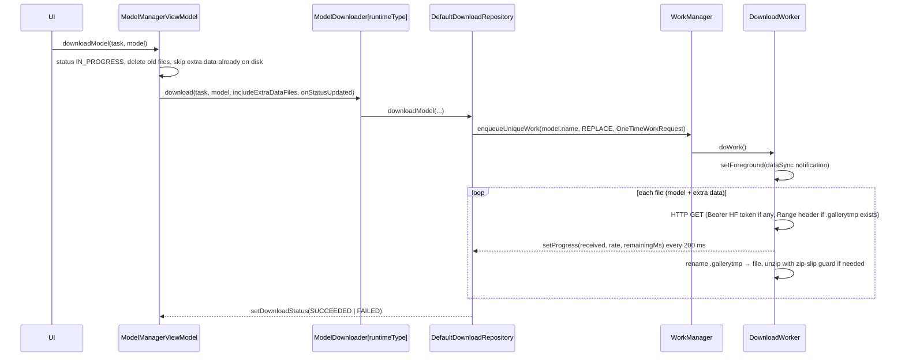

# Technical Design

## 1. Model catalog (allowlist)

### 1.1 Source resolution

`ModelManagerViewModel.loadModelAllowlist()` runs on `Dispatchers.IO` and tries these sources in order:

| Order | Source | Notes |
|-------|--------|-------|
| 1 | `/data/local/tmp/model_allowlist_test.json` | Developer override (`adb push`). The UI shows a warning while it is active. |
| 2 | `https://raw.githubusercontent.com/google-ai-edge/gallery/refs/heads/main/model_allowlists/<versionName with "." → "_">.json` | e.g. `1_0_20.json`. On success the raw JSON is cached. |
| 3 | `<modelsDir>/model_allowlist.json` | Last good copy |

The allowlist is pinned to the app version. Each release needs its own file (see [11-build-ci-release](11-build-ci-release.md)).

### 1.2 Schema (`ModelAllowlist` / `AllowedModel`, parsed with Gson)

Top level: `models[]`, optional `aicoreRequirements.allowedDeviceGroups[]{groupName, description, deviceModels[]}`,
and optional `flags{}`. `flags` is parsed but **nothing reads it** in this build.

| Field | Type | Used for |
|-------|------|----------|
| `name` | string | Unique model id across tasks. Must not contain `/`. |
| `modelId` | string | Hugging Face repo (`org/repo`) |
| `modelFile` | string | File path inside the repo. The on-device file name is its base name. |
| `commitHash` | string | Version folder on disk and the download revision |
| `description` | markdown | Model info card |
| `sizeInBytes` | long | Progress and ETA |
| `defaultConfig` | object | `topK`, `topP`, `temperature`, `maxTokens`, `maxContextLength`, `accelerators` ("gpu,cpu"), `visionAccelerator`, `audioAccelerator` |
| `taskTypes` | string[] | Which tasks list this model (`BuiltInTaskId`) |
| `disabled` | bool | Skip the entry |
| `llmSupportImage` / `llmSupportAudio` | bool | Multimodal input |
| `llmSupportTinyGarden` / `llmSupportMobileActions` | bool | `LlmProfile` flags |
| `capabilities` | enum[] | `llm_thinking`, `speculative_decoding` |
| `capabilityToTaskTypes` | map | Which tasks may use each capability |
| `minDeviceMemoryInGb` | int | Memory warning |
| `bestForTaskTypes` | string[] | Pin and badge the model in those tasks |
| `url` | string | Overrides the Hugging Face resolve URL |
| `socToModelFiles` | map<soc, {modelFile,url,commitHash,sizeInBytes}> | Per-SoC NPU builds |
| `runtimeType` | enum | `litert_lm` (default), `aicore`, `unknown` |
| `aicoreReleaseStage` / `aicorePreference` | enum | `stable`/`preview`, `fast`/`full` |
| `parentModelName` / `variantLabel` | string | Model families and variants |
| `extraDataFiles[]` | `ModelDataFile` | Optional components downloaded alongside the model |
| `updatableModelFiles[]` / `updateInfo` | list / string | Lets the app keep using older versions already on disk |
| `localModelFilePathOverride` | string | Use a file already on the device |
| `modelType` | enum | `task` (default) or supplementary (not bound to a task) |
| `learnMoreUrl`, `metadata` | — | Display / reserved |

Default download URL: `https://huggingface.co/<modelId>/resolve/<commitHash>/<modelFile>?download=true`.

### 1.3 Filtering and conversion

Entries are skipped when:

- `disabled` is true;
- the runtime is AICore and the device isn't in `aicoreRequirements` (`isAICoreSupported`);
- the model is NPU-only and the device SoC (`Build.SOC_MODEL`) isn't in `socToModelFiles`.

`AllowedModel.toModel()` then builds the `Model`:

1. Parse the accelerator list (on Pixel: `npu` → `tpu`; Pixel 10 also drops `gpu`).
2. Build config editors (`createLlmChatConfigs`, `createLlmChatConfigsForNpuModel` or `createAICoreConfigs`; AICore caps temperature at 1.0).
3. Build `ModelDownloadInfo`, `BackendSpec`, `ModelHierarchy` and `LlmProfile`.

A model counts as an LLM when any of its `taskTypes` is an LLM task.

## 2. On-device storage layout

`getModelStorageDir(context)` = `context.getExternalFilesDir(null)`. It falls back to `filesDir`, and Pixel 11 `CD1A`
builds always use `filesDir`.

```
<modelsDir>/
├── model_allowlist.json                     # cached catalog
├── <normalizedName>/<version>/<file>        # downloaded model (normalizedName = name with [^a-zA-Z0-9] → "_")
├── <normalizedName>/<version>/<unzipDir>/   # when isZip
├── <normalizedName>/<version>/<file>.gallerytmp   # partial download
└── __imports/<file>                         # user-imported models
```

## 3. Download pipeline



- Gated models: `HuggingFaceApiClient.checkModelAccessibility` returns `ACCESSIBLE`, `GATED` (403), `NEEDS_TOKEN_EXCHANGE` (401), or `ERROR`.
  The OAuth flow (AppAuth, `read-repos` scope, endpoints `huggingface.co/oauth/authorize|token`) stores the
  access token, refresh token, and `expiresAtMs` in `user_data.pb`.
- On startup `processPendingDownloads()` cancels all workers, then re-enqueues every model whose status is `PARTIALLY_DOWNLOADED`.
- AICore models (`autoDownloadsOnStartup`) are downloaded or probed through ML Kit at startup. They can't be cancelled or deleted from the app.

Status enum (`ModelDownloadStatusType`): `NOT_DOWNLOADED`, `PARTIALLY_DOWNLOADED`, `IN_PROGRESS`, `UNZIPPING`,
`SUCCEEDED`, `FAILED`, `UNAVAILABLE`.

## 4. Inference runtimes

### 4.1 Contract (`runtime/LlmModelHelper`)

`initialize`, `resetConversation`, `runInference(model, input, resultListener, cleanUpListener, onError, images, audioClips, extraContext, responseJsonSchema)`,
`stopResponse`, `cleanUp`, and optional `countTokens` / `countInputTokens`.
`ResultListener = (partial: String, done: Boolean, partialThinking: String?) -> Unit`.

### 4.2 LiteRT-LM (`ui/llmchat/LlmChatModelHelper`)

| Step | Detail |
|------|--------|
| Backend | `Accelerator` → `Backend.CPU()`, `Backend.GPU()`, or `Backend.NPU(nativeLibraryDir)` (TPU maps to NPU) |
| Vision backend | `currentVisionAccelerator` (default GPU; GPU is required for Gemma 3n) |
| Audio backend | Always `Backend.CPU()` when audio is on (required for Gemma 3n) |
| `EngineConfig` | `modelPath`, `backend`, `visionBackend?`, `audioBackend?`, `maxNumTokens = MAX_TOKENS config`, `cacheDir` (external files dir only for models in `/data/local/tmp`) |
| Speculative decoding | On only if `ModelInfo.hasSpeculativeDecodingSupport()`, the capability is allowed for the task, **and** the user turned on `ENABLE_SPECULATIVE_DECODING` |
| Conversation | `ConversationConfig` with system instruction, tools (`ToolProvider`s), `SamplerConfig(topK, topP, temperature)`, initial messages, and optional constrained decoding / response format |
| Instance | `LlmModelInstance(engine, conversation, metricsTracker)` stored in `Model.instance` |
| Thinking | Output on the `thought` channel (`THOUGHT_CHANNEL`) is streamed as `partialThinking` |

Native library packaging: `pickFirsts += "**/liblitertlm_jni.so"`. The manifest declares optional vendor libraries
(`libOpenCL.so`, `libcdsprpc.so`, `libedgetpu_*.so`, `libvndksupport.so`) for GPU, DSP and TPU acceleration.

### 4.3 AICore (`runtime/aicore/AICoreModelHelper`)

Uses ML Kit GenAI Prompt (`GenerativeModel`, `generateContentRequest`, `ModelPreference`, `ModelReleaseStage`).
The runtime keeps no conversation state of its own. With `multi_turn_vision_session=true`, the helper prepends the
system instruction and re-attaches the latest image to later turns. Image count is limited to 1
(`MAX_IMAGE_COUNT_AI_CORE`). Context compaction is never offered for AICore models.

### 4.4 MediaPipe

| Use | API |
|-----|-----|
| Scrapbook segmentation | `tasks-vision` `InteractiveSegmenter` (model "Magic touch") |
| Embeddings (EmbeddingGemma 2) | `tasks-retrieval` `UniversalEmbedder` wrapped by `UniversalOnDeviceEmbedder` (text, image, and audio parts; NPU, GPU, or CPU delegate) |
| Retrieval | `SemanticRetriever` + `SqliteVectorStore` (persistent) or `InMemoryVectorStore` (cosine similarity) |

## 5. Sessions, chat history, and context

- `DefaultLlmSessionManager` assumes **one active session**. Session ids are UUIDs. A session can switch models.
- History is stored as `ChatSessionProto` / `ChatMessageProto` inside `UserData.chat_sessions` (`user_data.pb`).
  Image messages store file paths (`image_file_paths`). Audio clips are stored in `AudioMessageProto`.
- System prompts can be customized per task (`SystemPromptRepository`, key `system_prompt_<taskId>`).
- Context compaction (`SummarizationContextCompactor`): threshold 75% of max tokens. The summary budget is
  `tokensLeft × 0.75` words, clamped to 50–1000. It backs off for 3 checks after a failure. **Disabled in this build** by
  `Config.isContextCompactEnabled() = false`.

## 6. Persistence

All files are Proto DataStores (protobuf-lite) under `filesDir/datastore/` unless noted.

| File | Proto | Contents | Provided by |
|------|-------|----------|-------------|
| `settings.pb` | `Settings` | Text input history (max 50), imported models, ToS/Gemma acceptance, viewed promos, analytics opt-out, per-task auto-compaction, theme | `AppModule` |
| `user_data.pb` | `UserData` | **Secrets** (skill API keys), **HF access/refresh token**, **chat sessions**, **MCP auth headers** | `AppModule` |
| `skills.pb` | `Skills` | Skill index and selection state | `AppModule` |
| `mcp_servers.pb` | `McpServers` | MCP servers and tool flags | `AgentChatTaskModule` |
| `cutouts.pb` | `CutoutCollection` | Scrapbook cutouts | `AppModule` |
| `benchmark_results.pb` | `BenchmarkResults` | Benchmark history | `AppModule` |
| `video_moment_finder.pb` | `VideoMomentFinderData` | Projects, clips, saved moments | `VideoMomentFinderTaskModule` |
| `onboarding_data.pb` | onboarding | Feature onboarding state | `OnboardingModule` |
| `filesDir/scheduled_notifications.pb` | `ScheduledNotification` list | Local notifications | `NotificationScheduleManager` |
| SharedPreferences `photo_library_prefs` | — | Removed assets, custom URIs, full-library flag, max MediaStore count | `PhotoLibraryService` |
| `smart_album_vectors.db`, `smart_album_samples.db`, `semantic_retrieval_gemma.db` | SQLite (MediaPipe) | Embedding vectors | `GemmaEmbeddingModelStore.getDatabasePath` |

None of these stores are encrypted (`androidx.security:security-crypto` is a declared dependency but is unused).
See [10-security-privacy](10-security-privacy.md).

## 7. Background work and notifications

| Component | Mechanism | Notes |
|-----------|-----------|-------|
| `DownloadWorker` | `CoroutineWorker`, unique work per model name, `REPLACE` | Foreground `dataSync`. Download notification channel. |
| `SmartAlbumIndexingWorker` | `CoroutineWorker`, per `SmartAlbumSource` | Foreground. Inputs: model path, accelerators, max sequence length, vision token budget |
| `NotificationScheduleManager` | `AlarmManager.RTC_WAKEUP` (one-off or `INTERVAL_DAY`) | Restored on boot by `BootReceiver` |
| `GalleryFcmMessagingService` | Firebase Cloud Messaging | Data `title`, `body`, `image`, `deeplink`. Channel `gallery_high_priority_push_channel`. |

## 8. Configuration system

- `ConfigKeys` defines every tunable (`max_tokens`, `topk`, `topp`, `temperature`, `accelerator`, `vision_accelerator`,
  `enable_thinking`, `enable_speculative_decoding`, `visual_token_budget`, benchmark keys, …).
- `Config` subclasses map to editor widgets (`ConfigEditorType`: label, number slider, switch, segmented button, bottom-sheet selector, dropdown).
- `needReinitialization = true` means changing the value re-initializes the model (unless the task handles config itself).
- Values live in `Model.configValues` (not persisted across launches for allowlist models **[inferred]**).
- Defaults: `topK = 64`, `topP = 0.95`, `temperature = 1.0`, `maxTokens = 1024`, accelerators `[GPU]`, vision `GPU`.

## 9. Threading model

| Work | Dispatcher |
|------|------------|
| Allowlist load, file I/O, downloads, DataStore | `Dispatchers.IO` / `@IoDispatcher` |
| Model initialization (task `initializeModelFn`) | Called from `Dispatchers.IO`. Tasks often launch on `Dispatchers.Default`. |
| Tool execution | `runBlocking(Dispatchers.Default | IO)` inside LiteRT-LM tool callbacks |
| UI state | `StateFlow` collected in Compose (`collectAsStateWithLifecycle`) |
| Process-wide | `@ApplicationScope` = `SupervisorJob() + IO` |

Many DataStore reads and writes are wrapped in `runBlocking` (`DefaultDataStoreRepository`), so they block the calling thread.

## 10. Telemetry and metrics

- Firebase Analytics is active only when `google-services` is configured. In the open-source build the plugin is
  `apply false`, `Firebase.analytics` throws, and the code falls back to `null`.
- Events (`GalleryEvent`): `capability_select`, `model_download`, `generate_action`, `button_clicked`,
  `skill_management`, `skill_execution`, `chat_history`, `mcp_management`, `mcp_execution`, `model_config_change`,
  `model_initialize`, `inference_metrics`, `context_compression`, `auto_compaction_enable`, `resource_link_click`, and `APP_OPEN`.
- Inference metrics (`InferenceMetricsParam`): TTFT, prefill/decode speed, token counts, latency, peak/avg memory,
  accelerator, sampler config. Collected by `LitertlmInferenceMetricsTracker`, `MemoryMonitor`, and `PowerMonitor`.
- The user can opt out in Settings (`disable_firebase_analytics`).

## 11. Feature flags

| Flag | Location | Value in this build |
|------|----------|---------------------|
| Context compaction | `Config.isContextCompactEnabled()` | `false` (hard-coded) |
| LiteRT-LM benchmark mode | `ExperimentalFlags.enableBenchmark` | `false` |
| Speculative decoding | `ExperimentalFlags.enableSpeculativeDecoding` | Set per init, then reset |
| Remote flags | `ModelAllowlist.flags` | Parsed, unused |
| Featured skills | `SKILL_ALLOWLIST_URL` | `""` (featured list off) |
| Example task | `ExampleCustomTaskModule` | Commented out |
